<picture>
  <source media="(max-width: 600px) and (prefers-color-scheme: dark)" srcset="./banner-mobile-dark.svg">
  <source media="(max-width: 600px)" srcset="./banner-mobile-light.svg">
  <source media="(prefers-color-scheme: dark)" srcset="./banner-dark.svg">
  
</picture>

<picture><source media="(max-width: 600px) and (prefers-color-scheme: dark)" srcset="./cards/enver-mobile-dark.svg"><source media="(max-width: 600px)" srcset="./cards/enver-mobile-light.svg"><source media="(prefers-color-scheme: dark)" srcset="./cards/enver-dark.svg"></picture>

<a href="https://github.com/EyakutDev/tomar"><picture><source media="(max-width: 600px) and (prefers-color-scheme: dark)" srcset="./cards/project-tomar-mobile-dark.svg"><source media="(max-width: 600px)" srcset="./cards/project-tomar-mobile-light.svg"><source media="(prefers-color-scheme: dark)" srcset="./cards/project-tomar-dark.svg"></picture></a>

<a href="https://github.com/EyakutDev/kucuk-konusma"><picture><source media="(max-width: 600px) and (prefers-color-scheme: dark)" srcset="./cards/project-kucuk-konusma-mobile-dark.svg"><source media="(max-width: 600px)" srcset="./cards/project-kucuk-konusma-mobile-light.svg"><source media="(prefers-color-scheme: dark)" srcset="./cards/project-kucuk-konusma-dark.svg"></picture></a>

<a href="https://github.com/EyakutDev/sosyo-bel"><picture><source media="(max-width: 600px) and (prefers-color-scheme: dark)" srcset="./cards/project-sosyo-bel-mobile-dark.svg"><source media="(max-width: 600px)" srcset="./cards/project-sosyo-bel-mobile-light.svg"><source media="(prefers-color-scheme: dark)" srcset="./cards/project-sosyo-bel-dark.svg"></picture></a>

<a href="https://github.com/EyakutDev/paydas_repo"><picture><source media="(max-width: 600px) and (prefers-color-scheme: dark)" srcset="./cards/project-paydas-mobile-dark.svg"><source media="(max-width: 600px)" srcset="./cards/project-paydas-mobile-light.svg"><source media="(prefers-color-scheme: dark)" srcset="./cards/project-paydas-dark.svg"></picture></a>

live: <a href="https://tomar.169-58-194-231.sslip.io/">Tomar</a> · <a href="https://kucukkonusma.169-58-194-231.sslip.io">Küçük Konuşma</a>

<picture><source media="(max-width: 600px) and (prefers-color-scheme: dark)" srcset="./cards/skills-mobile-dark.svg"><source media="(max-width: 600px)" srcset="./cards/skills-mobile-light.svg"><source media="(prefers-color-scheme: dark)" srcset="./cards/skills-dark.svg"></picture>

<a href="https://enveryakut.com/assets/cv.pdf"><picture><source media="(prefers-color-scheme: dark)" srcset="./cards/cv-tr-dark.svg"></picture></a> <a href="https://enveryakut.com/assets/cv-en.pdf"><picture><source media="(prefers-color-scheme: dark)" srcset="./cards/cv-en-dark.svg"></picture></a>

<a href="https://enveryakut.com"><picture><source media="(prefers-color-scheme: dark)" srcset="./cards/contact-site-dark.svg"></picture></a> <a href="mailto:yakutenver@gmail.com"><picture><source media="(prefers-color-scheme: dark)" srcset="./cards/contact-mail-dark.svg"></picture></a>

<picture><source media="(max-width: 600px) and (prefers-color-scheme: dark)" srcset="./cards/delete-mobile-dark.svg"><source media="(max-width: 600px)" srcset="./cards/delete-mobile-light.svg"><source media="(prefers-color-scheme: dark)" srcset="./cards/delete-dark.svg"></picture>
